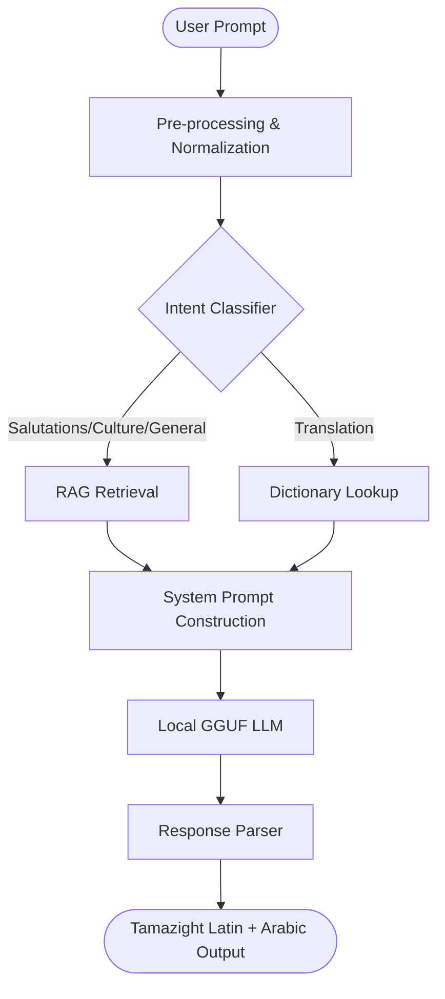

# AwalGPT ⵣ

AwalGPT is a state-of-the-art conversational AI assistant specialized in Moroccan Tamazight (Berber). By combining local Large Language Models (LLMs) with a custom Retrieval-Augmented Generation (RAG) pipeline and hybrid intent classification, AwalGPT provides accurate, culturally contextualized, and grammatically correct responses in both **Tamazight Latin (Arabizi)** and **Arabic script**.

---

## 🚀 Features

- **Local LLM Execution**: Uses a quantized GGUF chatbot model running entirely locally via `llama-cpp-python`.
- **Hybrid Intent Classification**: Parses user intent (translation, salutations, culture, learning, general information) using a machine learning model combining Word2Vec embeddings and a classifier.
- **Dictionary RAG**: Incorporates a dictionary lookup system and a curated QA dataset to translate words, retrieve definitions, and output accurate cultural facts in real-time.
- **Robust Backend**: Built with FastAPI, featuring asynchronous SQLite database management (`aiosqlite`) and secure JWT authentication.
- **Modern UI Frontend**: Built with React, featuring a clean, responsive glassmorphic design, chat histories, user authentication, and interactive conversation states.

---

## 📂 Project Structure

```text
├── backend/
│   ├── data/                 # JSON dictionaries, QA pairs, and intent keywords
│   ├── models/               # ML classifiers and GGUF models (GGUF ignored by Git)
│   ├── main.py               # FastAPI application, authentication routes, and endpoints
│   ├── pipline.py            # NLP pipeline, intent detection, RAG retrieval, and LLM inference
│   └── train.py              # Script to train/update the ML intent classifier
└── frontend/
    ├── public/               # Public assets and HTML entry template
    ├── src/                  # React source code (components, pages, context)
    ├── package.json          # Node dependencies and scripts
    └── styles.css            # Custom CSS styles (modern, dark/glassmorphic theme)
```

---

## 🛠️ Getting Started

### 1. Prerequisites
- Python 3.9+
- Node.js 16+
- Git

### 2. Backend Setup
1. Navigate to the backend directory:
   ```bash
   cd backend
   ```
2. Create and activate a virtual environment:
   ```bash
   python -m venv venv
   source venv/bin/activate  # On Windows use: venv\Scripts\activate
   ```
3. Install required packages:
   ```bash
   pip install -r requirements.txt
   # Or install dependencies manually: FastAPI, Uvicorn, llama-cpp-python, spacy, rapidfuzz, aiosqlite, PyJWT, bcrypt, numpy, scikit-learn
   ```
4. Download the spaCy model:
   ```bash
   python -m spacy download xx_ent_wiki_sm
   ```
5. **Download the GGUF model**:
   Place your GGUF model (e.g., `awal-chatbot-q4_k_m.gguf`) inside the `backend/models/` directory. *(Note: This file is ignored by Git due to its large size).*
6. Start the FastAPI server:
   ```bash
   uvicorn main:app --reload
   ```

### 3. Frontend Setup
1. Navigate to the frontend directory:
   ```bash
   cd ../frontend
   ```
2. Install Node packages:
   ```bash
   npm install
   ```
3. Create a `.env` file (if not present) and set your API base URL:
   ```env
   REACT_APP_API_URL=http://localhost:8000
   ```
4. Run the React development server:
   ```bash
   npm start
   ```

---

## 🤖 How the Pipeline Works



---

## 🔒 Security
- APIs do not expose any hardcoded keys. 
- Authentication uses secure passwords hashed using `bcrypt` and session tokens managed via `JSON Web Tokens (JWT)`.

---

## 📝 License
This project is licensed under the MIT License.
